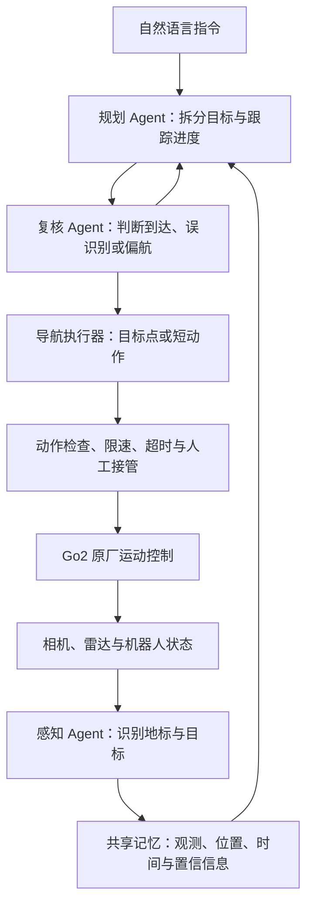

# Go2 EDU 上手与科研路线：导航、多 Agent VLN 和强化学习

调研日期：2026 年 11 月 5 日。

已确认条件：实验室已购买 Go2 EDU；目前只有机器狗，暂不研究机械臂和移动操作；重点是具身导航、多 Agent VLN、强化学习。用户已有 Hunter 建图和导航学习基础。

本笔记基于宇树官方代码、论文原文和作者项目页。老师提供的 [Google Drive 论文库](https://drive.google.com/drive/folders/1kdnYQYLmXowZmfyf9rPgQZ9GcDibHaWS?usp=sharing) 本次未能读取，因此未核实库内篇目和数量，也不声称以下论文都来自该库。本轮未连接或操控机器人，以下上手事项均待实机验收。

## 1. 建议采用的主线

**先把 Go2 做成可靠的导航实验平台，再复现一个 VLN 基线，随后研究多 Agent 协作，最后用强化学习优化一个明确的决策环节。**

初期保留原厂步行控制，由自己的程序决定导航目标、局部动作和停止时机。这样可以把研究集中在语言理解、视觉定位、历史记忆、协作效率和失败恢复。宇树 SDK2 的 Go2 接口提供 Move、StopMove、StandUp 等高层调用，也有另一套关节控制接口；选择哪一层，直接决定实验复杂度。[官方 SportClient 接口](https://github.com/unitreerobotics/unitree_sdk2/blob/main/include/unitree/robot/go2/sport/sport_client.hpp)

建议优先讨论的候选问题是：**在有限推理时间和调用预算下，机器人什么时候需要其他 Agent 帮助，什么时候应继续执行？** 这是本笔记提出的研究建议；其创新性还需要针对相关工作进一步核查。

## 2. 先分清要做的任务

| 任务 | 示例 | 主要研究内容 |
|---|---|---|
| 坐标导航 PointNav | 到地图上的某个位置 | 定位、路径规划、避障、到点判定 |
| 目标导航 ObjectNav | 找到一把椅子 | 目标识别、探索、语义地图 |
| 开放词汇目标导航 | 找到窗边的红色椅子 | 属性与空间关系理解、目标定位 |
| 视觉语言导航 VLN | 出门右转，经过饮水机，在第二个门前停下 | 视觉与语言对应、路线约束、进度记忆 |
| 多软件 Agent 的 VLN | 感知、规划、复核等角色共同控制一台 Go2 | 分工、信息共享、调用时机、错误纠正 |
| 多机器人协作 VLN | 两台机器人分别探索区域并分享发现 | 任务分配、通信、共享地图、路径冲突 |

目前一台 Go2 足以开展多软件 Agent 的实机研究。多机器人方案可先在仿真中研究，但一台狗的实验不能支持“多台实机协作已验证”的结论。

## 3. “把使用摸清楚”的具体验收标准

### 3.1 配置登记

先向设备管理员核对以下信息，形成一张配置表。EDU 有不同配置组合，官网配置不能直接代替这台机器的交付清单。[Go2 官方产品页](https://www.unitree.com/go2/)

| 项目 | 需要登记的内容 | 为什么影响研究 |
|---|---|---|
| 设备与软件 | EDU 具体配置、固件版本、App 版本、交付文档 | 决定接口和功能可用性 |
| 算力 | 是否有扩展计算模块、型号、内存；实验室 GPU | 决定模型放机载还是远端运行 |
| 相机 | 可访问的 RGB 图像；是否另有 RGB-D 相机、型号、内参 | 影响视觉定位、深度投影和论文复现 |
| 雷达 | 实际型号、点云获取方式、坐标系 | 影响建图与局部避障 |
| 网络 | 有线网口、机器与计算模块的实际地址、无线连接方式 | 决定数据通路和推理延迟 |
| 运维 | 遥控器、充电器、停止与人工接管方法 | 决定能否可靠开展实验 |

“目前只有机器狗”并不能确定相机和计算模块配置。特别要区分前置图像与深度图，记录真实可获取的数据。

### 3.2 日常操作

照对应设备版本的手册练习开关机、充电、遥控配对、站立/趴下、低速移动、正常停止和紧急接管。官方入口提供用户手册、手持遥控器手册、电池与充电器手册及教学视频。[官方手册与教程入口](https://www.unitree.com/app/go2/)

初次实验选择开阔平地，由现场人员持遥控器监护；先验收停止、接管和通信中断后的行为，再扩展任务。紧急处理方式按实际固件和手册确认，不凭旧教程猜测按键。发布动作的示例程序可能在启动后立即使机器人运动，运行前应检查源码。

### 3.3 开发连接与只读数据

宇树官方 ROS 2 仓库将 Ubuntu 22.04 + ROS 2 Humble 列为推荐的已测试组合，使用 CycloneDDS 通信。初次接入优先采用有线连接，并按文档选择实际网卡。机载已有系统应先查清；外部开发电脑的推荐环境不等于必须给机器人重装系统。[官方 ROS 2 文档](https://github.com/unitreerobotics/unitree_ros2)

建议与已有 Hunter 环境分开配置，避免沿用另一台机器的 DDS 域、网卡设置或启动脚本。文档中的 IP 和网卡名都是需要结合实物确认的配置，不应照抄。

先完成以下只读验收：

1. 能发现机器人状态数据，区分运动状态、IMU、关节与电池信息。
2. 能取得图像和点云，并记录分辨率、实际频率、时间戳、坐标系。
3. 能记录一段人工遥控采集的数据，并在断开机器人后回放。
4. 能识别数据超时、定位失效和图像滞后。

已配置好对应环境后，第一条检查可用 `ros2 topic list`。官方示例涉及 `/sportmodestate`、`/lowstate`、`/utlidar/cloud`，也有低频状态话题；实际名称和可用性以本机发现结果为准。图像可参考 SDK2 Python 的相机接口，也可以接入实际配备相机的驱动。[官方 ROS 2](https://github.com/unitreerobotics/unitree_ros2)、[SDK2 Python](https://github.com/unitreerobotics/unitree_sdk2_python)

### 3.4 程序控制与导航

在完成现场准备后，单独验收高层接口的小范围移动、转向、正常停止、遥控接管和指令超时保护。语言模型负责较慢的任务决策，运动执行程序负责持续反馈和及时停止。

接入 Nav2 等导航系统时，需要确认速度命令如何转换为 Go2 接受的请求。宇树官方 ROS 2 示例通过 `/api/sport/request` 发送高层控制请求；不能仅凭系统出现了 `/cmd_vel` 就认为控制已经接通。[官方 ROS 2 控制接口](https://github.com/unitreerobotics/unitree_ros2)

建议先做室内平地的“建图—定位—给定坐标导航—到点停止”。将失败分为定位、障碍感知、规划、速度执行、到点判定几类。四足机器人需要重新核对机体尺寸、相机姿态、身体起伏、转弯和避障参数，不能原样使用 Hunter 参数。

这个阶段应交付：配置表、个人启动说明、数据样例、一条可重复路线及失败记录。

## 4. 适合当前条件的系统结构

建议先采用以下结构；这是工程设计建议，并非某篇论文的完整复现。

第一版可只有规划、感知、复核三个角色，共享记忆作为数据服务。导航执行、距离判断、超时停车等环节可由确定性程序完成，不需要每个环节都调用大模型。

各角色交换带来源的数据，例如目标标识、观测时间、位姿、任务阶段和执行结果。记录每次重规划的触发原因，让实验能够判断失败来自误识别、过时记忆还是执行偏差。

先建立“一个 Agent + 同一套工具和记忆”的对照，再增加多个角色。调用了更多模型或处理了更多图像，也可能提升表现；需要控制这些成本，才能评估分工本身是否有效。

## 5. 强化学习可以放在哪里

| 层级 | 策略学习什么 | 方法与准备 | 本阶段建议 |
|---|---|---|---|
| Agent 调度 | 继续执行、重观察、检索记忆、请求规划或复核 | 先用规则实现，再考虑轻量 PPO 策略 | 最贴合多 Agent 主题，优先验证 |
| 局部导航 | 根据目标和障碍选择局部目标或速度 | 仿真中的 PPO 等；需建立可复用导航环境 | 可作独立方向，先有传统导航对照 |
| VLN 模型强化微调 | 改进语言/视觉到导航动作的策略 | SFT 后做 GRPO 等强化微调，需数据与训练算力 | 先复现推理，再评估训练条件 |
| 关节步态控制 | 输出关节动作，使机器人稳定跟踪速度 | Isaac Lab 训练，跨仿真检查，再上机 | 属于另一条实验链，暂作学习支线 |

VLN-R1 展示了 SFT 与 GRPO 强化微调结合的路线，实验以 VLN-CE 为主；它适合学习导航模型如何定义训练目标，本笔记没有把它列作已核实的 Go2 部署方案。[VLN-R1 原论文](https://arxiv.org/abs/2506.17221)

宇树的 `unitree_rl_lab` 官方提供包括 Go2 在内的强化学习环境。其 `unitree_mujoco` 当前明确以低层控制开发和验证为主，不能假设它完整模拟了原厂高层运动服务。模拟器保留的状态也未必能在关闭原厂控制后的实机上继续获得。[Unitree RL Lab](https://github.com/unitreerobotics/unitree_rl_lab)、[Unitree MuJoCo 说明](https://github.com/unitreerobotics/unitree_mujoco/blob/main/readme.md)

多个软件角色调用同一个模型，不自动构成“多智能体强化学习”。如果只训练调用调度器，应准确称为“强化学习调度的多 Agent VLN”；是否需要联合训练多个策略，应由任务和实验结果决定。

## 6. 一个可以开始检验的选题

**候选题目：面向长时程视觉语言导航的按需 Agent 协作与强化学习调度。**

核心假设：在简单路段持续调用所有 Agent 会浪费推理时间；在路口、地标歧义、记忆冲突和执行失败时增加协作，可能改善成功率与成本的平衡。需要先用实验确认这个现象。

最小任务示例：“离开房间后右转，经过饮水机，沿走廊到第二扇门前停止。”加入外观相似的门、需要回看的路口、可控的通路遮挡，观察何时出现错误。

### 最小对照实验

| 方案 | 调用方式 | 检验目的 |
|---|---|---|
| B0 | 单 Agent，拥有同样的感知工具和记忆 | 分工是否真正带来提升 |
| B1 | 每个决策周期固定调用全部 Agent | 固定协作的效果与代价 |
| B2 | 用规则在路口、停滞等情况触发协作 | 简单策略是否已经足够 |
| B3 | 轻量 RL 策略学习调用时机 | 学习是否优于手写规则 |

先让 B0—B2 正常运行并形成失败统计，再决定是否值得训练 B3。各方案使用相同基础模型、工具、传感器输入和测试任务；同时做匹配总调用/推理预算的比较，记录完整成本曲线。

RL 的观测可包含任务阶段、近期动作与结果、重复访问情况、可用地标、数据新鲜度和当前预算。动作可以是继续、重新观察、检索、调用规划、调用复核。奖励结合任务完成与进度，惩罚碰撞、超时、错误停止和无效调用。奖励权重在训练/验证集调节；测试集保持独立。

训练优先放在仿真。目标真实位置等信息可用于仿真奖励和评测，但不能泄露为部署时拿不到的策略输入。实机初期只执行已验证策略和预定路线，不用真实机器狗做无约束探索。

### 评测要求

- 导航：成功率 SR、路径效率 SPL、导航误差；有路线顺序约束时增加 nDTW 或子目标顺序完成率。
- 可靠性：碰撞、人工接管、错误停止、失败恢复。
- 协作成本：模型调用次数、token 用量、平均与高分位决策延迟、总任务时长。
- 泛化：未见房间、未见路线和不同措辞；严格隔离训练、调参与最终测试。
- 消融：去掉共享记忆、去掉复核、固定调用策略，与完整系统比较。

模拟评测可从 Habitat 中的 R2R-CE / RxR-CE 开始，它们是 VLN-CE 的标准任务资源。按所选论文固定依赖和数据版本，不将不同项目的安装说明混用。[VLN-CE 官方实现](https://github.com/jacobkrantz/VLN-CE)

真实实验先设计小规模预实验，统计常见失败和差异大小，再确定正式样本量。少数成功演示用于说明可运行，不足以证明方法普遍有效。

## 7. 优先阅读的五项工作

| 顺序 | 工作与时间 | 与当前方向的关系 | 已核实的证据边界 |
|---|---|---|---|
| 1 | [NaVILA](https://navila-bot.github.io/)，RSS 2025 | 理解语言导航与四足运动执行如何衔接 | 作者展示 Go2 实机；完整方法包含专门的视觉运动策略 |
| 2 | [StreamVLN](https://arxiv.org/abs/2507.05240)，2025 首发、ICRA 2026 | 视频流、长期记忆、推理效率；适合优先评估为复现起点 | 原文有 Go2 实机，官方仓库发布部署说明 |
| 3 | [VLN-R1](https://arxiv.org/abs/2506.17221)，2025 预印本 | 学习 SFT、GRPO 与导航奖励设计 | 本次核实的是 VLN-CE 训练与评测方法，未确认 Go2 部署 |
| 4 | [MA-CoNav](https://arxiv.org/abs/2603.03024)，2026 年 3 月预印本 | 多角色分工、结构化记忆、局部与全局反思 | 摘要描述基于 Limo Pro 采集的室内数据集，不能据此声称 Go2 闭环验证 |
| 5 | [MAVLN / TRISS](https://xyz9911.github.io/mavln/)，2026 年 9 月预印本 | 多机器人任务依赖、共享拓扑记忆、冲突处理 | 基准基于 Habitat 3 和 HM3D；适合拓展阅读，非一台 Go2 的直接等价任务 |

NaVILA 的价值在于理解分层。若只采用其高层思想并使用原厂步行，需在汇报中清楚说明与原方法的差异。[NaVILA 作者代码](https://github.com/AnjieCheng/NaVILA)

StreamVLN 是更值得先评估工程条件的一项：论文的实机系统使用 Go2、额外的 D455 相机和远端 RTX 4090 工作站；部署指南假设配有 D400 系列相机，发布了服务器与机器人客户端。该配置是作者的实验配置，不是本笔记断言的最低硬件要求。[论文实机设置](https://arxiv.org/html/2507.05240v2)、[部署指南](https://github.com/InternRobotics/StreamVLN/blob/main/realworld/realworld.md)

复现优先利用公开权重完成推理和评测。训练算力、显存、数据获取、相机适配和运动接口需要另行核对，不把“代码已发布”当成“下载即可在现有机器运行”。[StreamVLN 官方仓库](https://github.com/InternRobotics/StreamVLN)

每篇论文建议只记七项：具体任务、机器人与传感器、输入输出、方法贡献、训练条件、评测设置、代码/权重/数据是否可获得。将“仿真实验”“实机数据集”“实机闭环任务”分开记录。

老师的论文库可按 `Go2`、`vision-language navigation`、`embodied navigation`、`multi-agent`、`memory`、`reinforcement learning`、`GRPO` 搜索。先读与当前问题贴近的少量工作，再逐步扩展。

## 8. 建议的六周推进节奏

这是阶段目标，不是对完成时间或论文产出的承诺；取决于设备权限、传感器、GPU 和数据条件。

| 阶段 | 重点 | 可验收成果 |
|---|---|---|
| 第 1 周 | 配置登记、手册操作、数据读取和录制 | 配置表、操作说明、可回放数据、停止/接管记录 |
| 第 2 周 | 平地建图定位与坐标导航 | 固定路线重复实验、失败分类 |
| 第 3 周 | 评估 StreamVLN 等公开权重与仿真环境 | 一项基线的小规模评测；明确实机适配缺口 |
| 第 4 周 | 单 Agent 与固定/规则多 Agent | 同任务、同预算的对照结果和调用日志 |
| 第 5—6 周 | 选择一个调度问题加入 RL | 仿真结果、消融和受控 Go2 迁移预实验 |

如果第三周发现复现依赖或算力限制，应先运行较小模型与简单技能接口的基线，保留同样的任务和评测协议；报告明确模型与方法差异。

## 9. 向老师汇报时应说明的结论

Go2 EDU 可以作为导航与具身智能的实验载体。当前配置下优先保留原厂步行控制，完成可重复的建图、定位和导航平台，再开展语言导航实验。

一台机器可以验证多个软件 Agent 的感知、规划和复核协作。强化学习优先用于明确的导航或协作决策问题。先做固定规则对照，再判断学习带来的收益，避免仅靠系统模块数量说明贡献。

已找到有 Go2 实机依据的 VLN 工作及官方部署资料；仍待核对本机相机、算力、固件和网络条件。下一项最具体的工作是完成配置表与只读数据验收，之后再进入程序控狗和导航实验。
