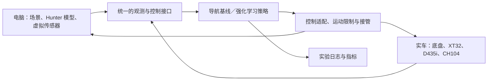

# Hunter 仿真与强化学习导航推进计划

日期：2026-10-12。当前交付的是规划，仿真环境尚未搭建，实车尚未连接。

## 1. 目标与本学期建议成果

建立一套属于自己的移动机器人科研平台：日常在电脑上开发、训练、重复实验；小车可用时做硬件核对、采集数据和阶段验证。师兄使用小车期间，电脑端工作可以继续推进。

当前方向是导航，后续可扩展到移动操作。先把底盘、感知、定位、规划和控制之间的关系理清，再选择有证据支持的研究问题。

建议本学期争取交付以下成果，作为与导师讨论的草案，而非已确认的验收要求：

1. 可重复启动的 Hunter 导航仿真，包含实验场景、模型、传感器、导航配置和实验记录。
2. 一个传统导航基线，以及一个能闭环运行的强化学习导航策略。
3. 相同任务条件下的对比结果，并完成受控实车测试，记录成功与失败原因。

“强化学习布上去”需要进一步明确：是先部署一个导航策略，还是要求完整复现指定论文的世界模型和训练流程。两者的工作量和资源要求不同。

## 2. 平台分成两层

第一层是机器人仿真底座，负责世界、底盘运动和传感器数据；第二层是实验层，负责导航算法、强化学习、重复测试和结果记录。

图中的仿真和实车是两个分别运行的环境，使用各自的启动配置与控制通道。

尽量复用研究代码、输入输出定义和评估方法；传感器驱动、启动文件、时间源与参数分别配置。实际部署前仍需检查版本、单位、坐标系、延迟和控制响应，不能保证复制文件就能直接运行。

URDF/Xacro 描述车体和关节；仿真器还要提供接触、碰撞与运动，控制器让指令作用于车轮，传感器模型产生观测。模型可以逐步对齐外形、尺寸、转向和安装位置；轮胎、摩擦、传感器噪声和延迟仍需通过数据校准，仿真跑通后要用实测确认有效范围。

一期建议保留建图、定位和全局规划，先研究一个明确的导航环节，例如局部避障与运动控制。机械臂联合控制留出安装坐标与软件接口，等课题确定后再增加。

## 3. 推荐路线与电脑资源

| 项目 | 初期建议 | 选择理由或待验证事项 |
|---|---|---|
| 系统 | 保留 Windows，在独立 Ubuntu 环境中运行机器人软件 | WSL2 可先做小规模图形和通信试运行；性能或兼容性不合适再考虑原生 Ubuntu |
| 新仿真平台 | 暂按 Ubuntu 24.04 + ROS 2 Jazzy + Gazebo Harmonic 规划 | 属于官方推荐配对；取回实车资产后检查模型、驱动接口与算法依赖再锁定版本 |
| 实车平台 | 保留现有 ROS 2 Humble | 不升级或改动共用系统；需要的个人包另行编译和验证 |
| 导航基线 | 复核师兄现有导航，建立自己的 Nav2 配置与测试 | 有启动文件不代表质量已验证；基线必须有可重复结果 |
| 强化学习 | Gymnasium 交互接口，先选 PPO 做小规模试验 | 便于学习观测、动作、奖励和训练；最终算法依据任务与对比结果选择 |
| 大规模训练 | 预留实验室服务器入口 | 训练与实车推理分开，减少对共享车辆的依赖 |

Gazebo 官方提供版本配对建议；Humble 默认配对 Fortress，Humble 与 Harmonic 需要额外适配。若已有关键软件难以迁移，再评估独立的 Humble 路线，不混用不同发行版的编译环境。[版本配对说明](https://gazebosim.org/docs/harmonic/ros_installation/)

WSL2 支持 Linux 图形应用，但本机的 Gazebo、ROS 与显卡表现尚未测试。[微软说明](https://learn.microsoft.com/en-us/windows/wsl/tutorials/gui-apps)

本机只读查询结果：i5-11260H、约 16 GB 内存、RTX 3050 Laptop、4 GB 显存。可以把本机作为轻量场景、接口调试和小策略试验的首个候选平台；复杂视觉输入、很多并行环境和完整世界模型训练需另测资源，不能承诺本机训练速度。服务器是否可用、显卡型号与使用安排均待确认。

先降低场景和观测复杂度，测出实际仿真速度、内存占用与单次训练耗时，再扩大规模。模型、数据与训练结果可安排在容量较充裕的 F 盘；Ubuntu 内的源码编译目录需单独规划。

## 4. 接车后需要收集的东西

以下均从已有系统只读查看，再复制到个人目录；不改师兄的文件。小车被别人使用时，先查静态文件，运行中的数据检查和运动测试另约时间。

| 资产 | 需要确认什么 | 用在哪里 |
|---|---|---|
| Hunter 型号与机器人模型 | 铭牌型号；URDF/Xacro、模型网格；车体尺寸、轴距、轮距、转向限制、载荷；碰撞和惯性设置 | 让仿真中的运动、占地和碰撞与实车相符 |
| 底盘控制接口 | 控制话题与消息类型、速度/转向含义和单位、限速、里程计来源、控制频率 | 连接传统控制器和学习策略，避免把底盘当作任意运动的小车 |
| 传感器与坐标系 | XT32、D435i、CH104 的话题、频率、安装位置、外参、相机内参；TF 关系 | 生成和处理与实车对应的观测 |
| 已有导航 | hunter_nav_odom_ws、launch、Nav2 参数、地图、定位配置、控制器与规划器版本 | 复用师兄成果，并测量实际表现 |
| 场景资料 | 实验室尺寸、门和通道、桌椅障碍；已有 PCD 和二维地图 | 构建可比较的任务与场景 |
| 原始数据和环境信息 | 可用时记录点云、图像、IMU、里程计、TF、控制数据；保存配置与软件版本 | 离线调试、分析失败、后续建模与实车对齐 |

现有 hz_ws 备份已经包含个人建图相关源码和配置，但不等于整个小车系统的备份。模型描述、师兄的导航工作区等仍需探查。启动助手绑定实车主机和硬件，不能通过在电脑上运行该助手得到仿真；需要新建仿真启动配置。

Hunter 有现成模型可以参考，例如社区提供的 Hunter V2 URDF 与 ROS 2 仿真、厂商旧仿真资源。先确认实验室车辆型号，再检查模型运动方式和软件依赖；已有资源能减少建模工作，但尚未验证可直接用于本机。[社区工程](https://github.com/LCAS/hunter_robot)、[厂商模型资源](https://github.com/agilexrobotics/ugv_gazebo_sim)

PCD 可帮助参考场景几何，仍需制作墙体、地面和障碍的碰撞模型。PCD 地图也不包含完整的同步图像、IMU 和传感器时间信息；这些需原始记录。回放可以检验算法处理已有数据，但不能直接替代会响应新控制动作的交互仿真。[rosbag2](https://github.com/ros2/rosbag2)

## 5. 阶段流程与进入下一阶段的条件

| 阶段 | 主要工作 | 阶段成果与检查条件 | 是否需要小车 |
|---|---|---|---|
| A：范围与资产 | 核对型号、模型、接口、已有导航和导师要求；检查平台版本兼容性 | 资产清单与缺项明确，选定一期任务和软件版本 | 文件探查时需要连接；不要求运动 |
| B：基础仿真 | 简单地面与障碍、正确底盘模型、运动控制、里程计、坐标关系和时间源 | 能按底盘真实约束移动和转弯；坐标与时间一致，稳定性和速度有记录 | 不需要 |
| C：导航基线 | 搭近似实验室场景，加入虚拟传感器、建图/定位、目标导航 | 固定任务可重复运行，有成功率、碰撞、耗时等结果 | 电脑先做；实车基线另约验证 |
| D：强化学习接口 | 明确观测、动作、奖励；实现重置、推进、结束与记录 | 每次动作确实作用于环境，观测与时间对应；失败和超时能正确结束 | 不需要 |
| E：训练与比较 | 训练初始策略，分离训练/测试场景；和导航基线比较 | 权重、配置、随机种子与结果可追溯；报告失败情况 | 本机或服务器 |
| F：实车部署 | 输入处理对齐、推理耗时测量、控制适配与接管；受控测试 | 闭环策略可运行；实测与仿真差异有记录，能可靠停止和接管 | 需要约定使用时间 |
| G：研究扩展 | 根据结果选择世界模型、地形适应或其他课题；后续加入机械臂 | 明确假设、基线、改进方法和验证指标 | 按研究需求分阶段安排 |

### B、C 阶段的重点

- 模型需要符合实车的运动限制，不能默认具有原地旋转能力。模型外观、运动学和碰撞形状分别检查。
- 先用少量墙体、通道和障碍建立可运行环境，再逐步增加实验室细节。需要研究哪些因素，就优先补齐哪些因素。
- 可先用简化激光观测建立导航闭环，再加入三维雷达、相机、IMU。若验证 FAST-LIVO2，还要检查虚拟点云字段、时间戳、坐标和标定是否符合个人版本的数据要求，不能默认通用点云可直接接入。
- 定位和导航测试可使用仿真真值做调试参照；报告必须区分真值定位与真实可用的定位方式。

### D、E 阶段的重点

将强化学习环境理解为四个问题：机器人现在看到什么、能做什么、怎样评估行为、何时结束一次任务。

一期候选设计：观测由目标相对位置、障碍信息、速度等构成；动作经适配器转换为底盘能接受的指令；奖励围绕接近目标、避免碰撞、减少停滞和控制抖动设计。具体维度、频率和单位等接口细节在资产核对后确定。

策略输入应能在实车获得。训练时可用真值计算奖励或评估，但应明确标注，不让部署策略依赖实车没有的输入。保存观测归一化参数、动作缩放规则和模型权重，部署时一起使用。

Gymnasium 负责交互环境的组织，PPO 是建议的第一个训练基线；它们尚未在本机安装或运行。[环境接口](https://gymnasium.farama.org/introduction/basic_usage/)、[PPO 文档](https://stable-baselines3.readthedocs.io/en/master/modules/ppo.html)

### F 阶段的重点

训练得到的策略部署后负责推理，不必在小车上重复完整训练。先测目标主机的推理延迟，再决定控制频率。

接入时检查坐标、单位、数据时效与动作范围；保持单一有效控制来源，加入限速、过期数据停机和人工接管。先在允许的低速、受控区域完成测试，再增加任务难度。所有新增代码和配置在个人目录内，师兄原系统保留用于参考与基线。

## 6. 实验如何帮助确定课题

导师说的“优化已有成果或补齐缺项”，可以落实为以下过程：

1. 列出师兄系统的已有功能，并区分“找到文件”“能实际运行”“效果测过”三种证据。
2. 在固定任务上建立自己的基线，收集转弯受限、碰撞、停滞、定位失效等具体失败案例。
3. 从案例提出可检验的改进假设，再决定算法与研究题目。

候选方向包括：受底盘转向限制的局部导航、控制延迟或地面变化下的适应、观测不确定时的决策。它们只是选题候选，尚不能据此声称有创新性。修复配置和驱动问题是建立基线的必要工作，也需与算法研究区分。

建议初始测试集包含约 20 个固定起终点任务，作为可调整的实验方案。传统导航和学习策略使用相同场景、速度限制、起终点与成功判定；训练场景与测试场景分开，并保存重复运行的随机种子。

主要记录：成功率、碰撞/接管次数、到达耗时、路径长度、停滞和控制平滑性。不要仅凭一段成功演示判断效果；也不预设强化学习一定优于现有导航。

## 7. Verti-WM 如何接到这条路线

论文研究越野车辆动力学的世界模型，用它训练导航策略；采用 Chrono/Verti-Bench，实测平台也不是 Hunter。它依赖提供的高程与语义地图。因此，Gazebo 导航底座可服务前期学习，完整论文复现另需核对数据、模型与地形条件。[论文全文](https://arxiv.org/html/2609.23118v1)

当前未核实作者官方代码、可下载数据/权重和训练 GPU 型号。完整复现应在这些条件明确后单列任务，与“部署一个导航策略”分别验收。

先阅读论文，把输入、动作、训练流程与评估方式画清楚；根据导师要求决定后续是否增加世界模型和越野仿真。不要等平台全部完美后才开始读论文，基础学习、平台建设和文献阅读可以并行。

## 8. 本学期参考安排

以下按开始后约 10～12 周估计，用于讨论优先级；不是已确认的截止日期，也不是工期保证。已有资产和软件兼容性会影响进度。

| 时间 | 主线工作 | 可展示成果 |
|---|---|---|
| 第 1～2 周 | 学硬件与 ROS 数据流；只读查资产；电脑环境试运行；读论文 | 资产表、接口图、平台版本决定 |
| 第 3～4 周 | 正确底盘与传感器；简化实验室；导航基线 | 可重复导航演示和初步指标 |
| 第 5～6 周 | 学强化学习基础；接入交互环境；小策略试验 | 一次完整训练流程、可保存的策略 |
| 第 7～9 周 | 多次训练、独立测试、与基线比较 | 对比表、失败案例、研究问题草案 |
| 第 10～12 周 | 实车接口核对、受控部署、差异分析 | 实车测试记录、报告、下一阶段计划 |

每周保留少量论文阅读与实车知识学习；需要车辆的事情集中预约，电脑实验每天可继续。若导师明确要求完整论文复现，则重新安排资源、里程碑与任务范围。

## 9. 连接小车后的单步顺序

当你说明已经连接小车后，按下面的顺序逐步进行，每次只给 1～2 条命令、解释目的，等你回传输出再决定下一步：

1. 确认机器、ROS 版本与现有工作区位置。
2. 查找 Hunter 描述文件和型号信息，核对车体与转向参数。
3. 查看传感器参数、坐标关系、底盘控制接口与启动配置。
4. 查看已有地图、Nav2 参数和软件依赖，整理完成项与缺项。
5. 把所需资产安全复制到个人目录，再传到电脑建立独立仿真工程。
6. 在约定的小车使用时间验证基线、检查数据流，按需要采集自己的数据。

当前不需要启动小车或执行这些步骤。下一次连接时从第 1 项开始，输出不符合预期就先解决该步。

## 10. 后续需要确认的事项

| 事项 | 何时确认 | 影响 |
|---|---|---|
| Hunter 的具体型号、转向与控制接口 | 首轮实车资产探查 | 模型选择与策略动作定义 |
| 师兄导航目前能做到什么、哪些情况失败 | 配置查看后，在约定时间验证 | 基线和可研究的缺项 |
| 导师希望本学期完成策略部署还是完整论文复现 | 尽早与导师沟通 | 范围、资源与验收 |
| 后续主要室内、室外还是越野 | 基线阶段前后 | 场景、感知与动力学需求 |
| 实验室训练服务器是否可用 | 小规模训练前 | 本机任务规模与训练安排 |
| WSL2 图形、ROS 与关键依赖表现 | 电脑环境试运行 | 最终系统与软件版本 |

这些未知项作为后续决策点保留，当前无需一次回答完。接车后先收集资产，让平台选择和研究安排有依据。
