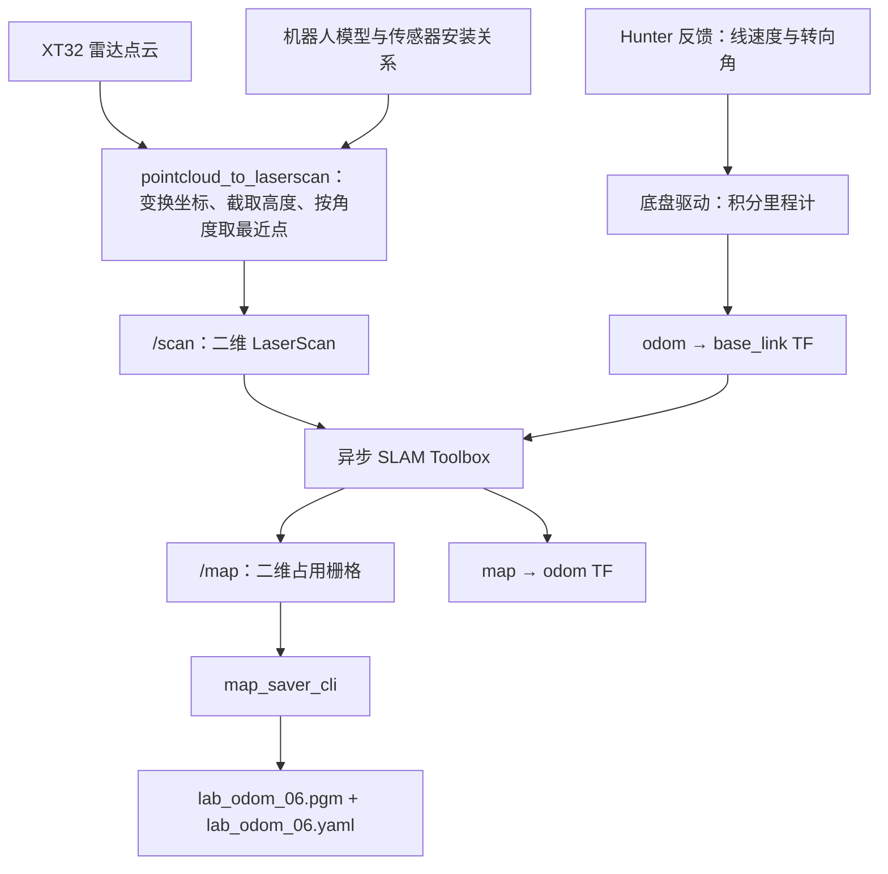

# 师兄的实验室二维建图方法：lab_odom_06 溯源记录

初次整理日期：2026-10-16。后续复用验证更新：2026-10-18。对象：小车 `car-NUC15JNKU7X4` 上于 2026-09-22 保存的 `lab_odom_06`。ROS 2 发行版：Humble。

本文归档已查明的方法、现存完整配置和证据缺口。最初的方法溯源为只读调查；后续在个人工作区完成地图副本准备、地图服务加载及栅格分类验证，见第 11 节。尚未重新建图、启动底盘或进行定位和导航实测。

## 1. 已经弄清什么

当晚日志中出现 Hunter 底盘、Hesai 雷达、机器人模型发布器、点云转扫描节点，以及三次启动的异步 SLAM Toolbox；随后 `map_saver_cli` 从 `map` 话题成功保存了 `lab_odom_06.pgm` 和 YAML。

结合历史扫描转换命令和现存底盘源码，**最有证据支持的还原是：XT32 三维雷达点云先转成二维扫描，再结合底盘里程计运行二维 SLAM，最后保存二维栅格图。** 这是同晚日志、命令历史与现存源码的交叉还原；保存日志本身没有记录 `/map` 发布者身份，未保留完整执行快照。

没有找到这张目标地图由 FAST-LIVO 点云离线转换生成的记录。车上另有 FAST-LIO、ScanContext、ICP 和旧二维地图，不能仅因这些文件共存，就把它们认定为 `lab_odom_06` 的生成流程。

| 调查项 | 证据及结论 |
| --- | --- |
| 地图身份与保存 | 保存日志明确记录目标路径、尺寸、分辨率及成功写入；用户确认图中覆盖扩建后的实验室 |
| 当晚 SLAM 程序 | 实际启动的是 `async_slam_toolbox_node`，不是凭参数文件名判断模式 |
| 完整 SLAM 参数文件 | 已保存现存文件全部内容；尚无当晚启动实参或参数转储，不能认定每项就是当晚生效值 |
| 原始行驶路线 | 在本次搜索范围内未找到对应轨迹、位姿图或录包，无法可靠恢复 |
| 成功回环 | 配置允许回环，但日志未给出成功回环记录；次数、位置、人工干预情况均未确定 |
| 地图精度与导航效果 | 外观看起来清晰；未取得现场测量、定位误差或导航验收数据 |

## 2. 硬件与数据如何连起来



其中底盘发布方式和传感器安装关系来自现存实现；当晚没有保存完整 TF 树供逐条核实。SLAM Toolbox 的标准输入是扫描及里程计坐标变换，图像地图保存与位姿图序列化是不同操作。[SLAM Toolbox Humble 接口说明](https://github.com/SteveMacenski/slam_toolbox/blob/humble/README.md)

### 底盘里程计

现存 `hunter_messenger.hpp` 读取底盘反馈的线速度和转向角，将内轮转角换算为等效中心转角，再用自行车运动学模型积分位置与航向，发布 `nav_msgs/msg/Odometry`。`publish_odom_tf` 控制是否发布 `odom → base_link`。

现存入口的默认名称为 `odom`、`base_link` 和 `odom` 话题。本轮没有证据证明当晚还运行了外部 IMU 融合或 FAST-LIVO 来提供这段里程计；不能把另一套工程里的融合节点补写到这条历史链路中。

源码参考：[底盘消息与里程计实现](F:/rob-memory/robot_assets/hunter_from_car_20261013_qjkgbbq5/hunter_base/include/hunter_base/hunter_messenger.hpp)、[底盘参数与模型选择](F:/rob-memory/robot_assets/hunter_from_car_20261013_qjkgbbq5/hunter_base/src/hunter_base_ros.cpp)。这些是 10 月导出的现存源码，不能代替当晚已编译程序的版本证明。

### 三维雷达如何得到二维扫描

历史记录中的转换节点先把点变换到 `base_link`，筛选 Z 高度范围，再按水平方向的角度分格，在每个方向保留相应最近距离，输出 `/scan`。它处理的是实时单帧点云；此步骤本身不使用已经拼接好的完整 PCD 地图。[pointcloud_to_laserscan Humble 说明](https://github.com/ros-perception/pointcloud_to_laserscan/blob/humble/README.md)

这解释了为什么三维 XT32 雷达也能用于二维 SLAM。最终地图是二维，并不表示传感器本身是二维雷达。

## 3. 当晚的可核对时间线

时间使用小车当时显示的日期与本地时区。进程启动时间不是采集起止时间，也不能证明此前没有运行过其他会话。

| 2026-09-22 时间 | 日志记录 |
| --- | --- |
| 22:41:57 | `hunter_base_node` 启动，PID 48663 |
| 22:42:05 | `hesai_ros_driver_node` 启动，PID 49072，同时启动 RViz |
| 22:42:18 | `robot_state_publisher` 启动，PID 49532 |
| 约 22:42:32 | 点云转扫描节点日志文件名对应 PID 49978 |
| 22:44:25 | 第一轮异步 SLAM 开始打印启动信息，PID 50809 |
| 22:46:00 | 第一轮收到 SIGINT/SIGTERM；随后第二轮启动，PID 50875 |
| 22:48:03 | 第二轮收到 SIGINT/SIGTERM |
| 22:48:21 | 第三轮异步 SLAM 启动，PID 50995 |
| 22:50:52 | `map_saver_cli` 从 `map` 话题成功保存目标地图 |
| 22:51:36 | 转换节点报告一个新 `/scan` 订阅者的可靠性 QoS 不兼容 |

三轮 SLAM 都记录了：栈大小 40000000、CeresSolver、SCHUR_JACOBI，以及 SLAM 最低量程 0.0 与收到的扫描最低量程 0.5 不一致的提醒。前两轮退出与转换节点的订阅者变化时间相符；按需启停点云订阅本身不等于雷达断连。

三轮之间是否重新加载过地图或位姿图，没有启动实参可以确认。**不能把三轮运行时间直接相加，称为这张图的实际建图时长。**

QoS 提醒发生在保存之后约 44 秒，且只指向不兼容的新订阅者，不能据此判定保存前建图失败，也不能确定该订阅者是谁。

## 4. 地图文件本身

车端原路径：`/home/car/hunter_nav_odom_ws/src/hunter_nav_odom/maps/lab_odom_06.pgm`，配套同名 YAML。原文件只读保留。

| 项目 | 记录 |
| --- | --- |
| 保存时间 | 2026-09-22 22:50:52 |
| 图像大小 | 287 × 469 像素 |
| 分辨率 | 0.05 m/格，即 5 cm/格 |
| 栅格矩形覆盖范围 | 14.35 m × 23.45 m，包含未知区域，不等于实验室净尺寸 |
| PGM 字节数 | 134618 |
| YAML 字节数 | 129 |

完整 YAML：

```yaml
image: lab_odom_06.pgm
mode: trinary
resolution: 0.05
origin: [-1.31, -15.4, 0]
negate: 0
occupied_thresh: 0.65
free_thresh: 0.25
```

`origin` 是栅格在地图坐标中的原点，不是已知的机器人起点或路线。保存日志中未指定阈值、格式时使用默认值的提醒，随后伴有成功写入记录，不能单独当成保存失败。

归档副本：[PGM 地图](F:/rob-memory/outputs/senior_mapping_method_20261016/reference_assets/lab_odom_06.pgm)、[地图 YAML](F:/rob-memory/outputs/senior_mapping_method_20261016/reference_assets/lab_odom_06.yaml)。地图和元数据的处理语义可对照 [Nav2 Humble map_io 实现](https://github.com/ros-navigation/navigation2/blob/humble/nav2_map_server/src/map_io.cpp)。

## 5. 扫描转换参数：必须区分两套证据

历史命令在 `.bash_history` 行 938、1622、1933 出现过；历史文件没有给出这些行对应的精确运行时间。因此完整命令是历史使用线索，量程 0.50 与当晚日志有交叉支持，其余各项不能自动升级为当晚生效参数。

| 项目 | 历史命令记录 | 现存 base_sensors.launch.py |
| --- | --- | --- |
| 输入点云 | `/lidar_points_direct` | `/lidar_points` |
| 转换节点名称 | 默认 `pointcloud_to_laserscan` | `xt32_to_scan` |
| 输出扫描 | `/scan` | `/scan` |
| 目标坐标系 | `base_link` | `base_link` |
| TF 容差 | 0.1 s | 0.05 s |
| 最低 Z | 0.10 m | -0.30 m |
| 最高 Z | 0.85 m | 0.30 m |
| 最小距离 | 0.50 m | 0.20 m |
| 最大距离 | 20.0 m | 20.0 m |
| 最小/最大角度 | -3.14159 / 3.14159 rad | 相同 |
| 角度间隔 | 0.00872665 rad，约 0.5° | 相同 |
| scan_time 字段 | 0.10 s | 0.10 s |
| use_inf | true | true |
| inf_epsilon | 命令未显式指定 | 1.0 |

高度相对于 `base_link`，不能直接理解为离地高度；`scan_time` 是消息字段，不能独自证明实际输出频率。输入话题名也不能独自证明当晚究竟由哪个节点发布，需要话题连接记录。

Humble 的量程处理代码会在配置最低量程小于收到扫描的最低量程时，提高内部最低量程。因此日志的 0.0/0.5 提醒与转换命令的 0.50 相符，但不直接证明 XT32 硬件的物理盲区。[Humble laser_utils.cpp](https://github.com/SteveMacenski/slam_toolbox/blob/humble/src/laser_utils.cpp)

现存入口参考：[base_sensors.launch.py](F:/rob-memory/robot_assets/hunter_from_car_20261013_qjkgbbq5/hunter_nav_odom/launch/base_sensors.launch.py)。它与历史命令有明显差异，不能直接当作当晚全部配置。

## 6. 现存完整 SLAM 参数

车端文件：`/home/car/hunter_nav_odom_ws/src/hunter_nav_odom/config/mapper_params_online_sync.yaml`。

从此前实车导出包读取的成员修改时间为 2026-09-13 10:49:23；其 `.bak_before_maprate` 备份为同日 10:44:43。逐项对照有效参数，区别为 `map_update_interval`：现文件 0.2，备份 5.0。成员时间早于目标地图，且部分参数与运行日志相符，但仍未找到当晚明确加载该文件的命令或参数转储。

最后一轮关键词检查还发现 `/home/car/nav2_ws/src/xt32_nav_bringup/config/slam_toolbox_online.yaml`，但没有它绑定到目标会话的记录，不能将其中参数混入此文件或认定它当晚被加载。

**下面是现存文件的完整内容，含 54 项显式配置，不是“当晚完整生效参数”的认证。** 它没有穷尽程序默认参数、launch 覆盖值、ROS 环境和 TF 外参。

```yaml
slam_toolbox:
  ros__parameters:

    # Plugin params
    solver_plugin: solver_plugins::CeresSolver
    ceres_linear_solver: SPARSE_NORMAL_CHOLESKY
    ceres_preconditioner: SCHUR_JACOBI
    ceres_trust_strategy: LEVENBERG_MARQUARDT
    ceres_dogleg_type: TRADITIONAL_DOGLEG
    ceres_loss_function: None

    # ROS Parameters
    odom_frame: odom
    map_frame: map
    base_frame: base_link
    scan_topic: /scan
    use_map_saver: true
    mode: mapping

    # if you'd like to immediately start continuing a map at a given pose
    # or at the dock, but they are mutually exclusive, if pose is given
    # will use pose
    #map_file_name: test_steve
    #map_start_pose: [0.0, 0.0, 0.0]
    #map_start_at_dock: true

    debug_logging: false
    throttle_scans: 1
    transform_publish_period: 0.02 #if 0 never publishes odometry
    map_update_interval: 0.2
    resolution: 0.05
    min_laser_range: 0.0 #for rastering images
    max_laser_range: 20.0 #for rastering images
    minimum_time_interval: 0.20
    transform_timeout: 0.2
    tf_buffer_duration: 30.
    stack_size_to_use: 40000000 #// program needs a larger stack size to serialize large maps
    enable_interactive_mode: true

    # General Parameters
    use_scan_matching: true
    use_scan_barycenter: true
    minimum_travel_distance: 0.5
    minimum_travel_heading: 0.5
    scan_buffer_size: 10
    scan_buffer_maximum_scan_distance: 10.0
    link_match_minimum_response_fine: 0.1  
    link_scan_maximum_distance: 1.5
    loop_search_maximum_distance: 3.0
    do_loop_closing: true 
    loop_match_minimum_chain_size: 10           
    loop_match_maximum_variance_coarse: 3.0  
    loop_match_minimum_response_coarse: 0.35    
    loop_match_minimum_response_fine: 0.45

    # Correlation Parameters - Correlation Parameters
    correlation_search_space_dimension: 0.5
    correlation_search_space_resolution: 0.01
    correlation_search_space_smear_deviation: 0.1 

    # Correlation Parameters - Loop Closure Parameters
    loop_search_space_dimension: 8.0
    loop_search_space_resolution: 0.05
    loop_search_space_smear_deviation: 0.03

    # Scan Matcher Parameters
    distance_variance_penalty: 0.5      
    angle_variance_penalty: 1.0    

    fine_search_angle_offset: 0.00349     
    coarse_search_angle_offset: 0.349   
    coarse_angle_resolution: 0.0349        
    minimum_angle_penalty: 0.9
    minimum_distance_penalty: 0.5
    use_response_expansion: true
    min_pass_through: 2
    occupancy_threshold: 0.1
```

归档文件：[现存完整参数](F:/rob-memory/outputs/senior_mapping_method_20261016/reference_assets/mapper_params_online_sync.yaml)、[刷新间隔修改前备份](F:/rob-memory/outputs/senior_mapping_method_20261016/reference_assets/mapper_params_online_sync.yaml.bak_before_maprate)。

### 如何理解关键设置

- `resolution: 0.05` 与实际保存地图一致。
- `map_update_interval: 0.2` 是栅格更新间隔；备份为 5.0。它不代表配准精度，也不是实际建图速度或雷达频率的测量。
- `transform_publish_period: 0.02` 是设计的 `map → odom` 发布周期，不是底盘里程计周期的实测证明。
- `minimum_travel_distance: 0.5`、`minimum_travel_heading: 0.5` 是候选扫描更新门槛；不能由它们倒推出真实速度、行驶路线或处理扫描数量。
- `do_loop_closing: true` 允许寻找回环；搜索距离、链长度和响应阈值只是配置条件，不能证明发生过有效回环。
- `enable_interactive_mode: true` 只说明允许相关功能，不能证明师兄人工调整过图节点。
- `throttle_scans` 和 `minimum_time_interval` 的适用方式需要结合节点模式和版本，不能看到后者为 0.20 就声称当晚异步节点固定以 5 Hz 工作。

文件名带 `online_sync`，而当晚节点明确为异步。上游 Humble 异步 launch 可以通过 `slam_params_file` 另选 YAML，所以二者不必矛盾；也正因如此，单凭文件名无法确认加载关系。该上游入口还会覆盖 `use_sim_time`，未来实车复现应核对本机入口并明确使用实时时钟，不能用文件中没有这一项来推断当晚值。[Humble 异步 launch 实现](https://github.com/SteveMacenski/slam_toolbox/blob/humble/launch/online_async_launch.py)

## 7. 为什么地图可能看起来比较清楚

这条链路的合理解释是：筛选高度后关注墙壁、桌腿等平面结构；连续扫描匹配帮助对齐观测；里程计提供运动初值；最后以 5 cm 栅格和三值图像显示，轮廓会比完整三维点云更简洁。

这是基于方法结构的解释，**没有做因果消融实验，不能断言某个参数、某条路线或成功回环就是这张图清晰的决定因素**。尤其不能把“三维细节多”与“二维导航质量差”画等号；两种图表达的信息和使用目的不同。

## 8. 原路线与回环：本次能确认到哪里

本次查找了两个参考工作区、`.ros`、`/tmp`，以及 `/home/car` 中可访问的普通文件。搜索覆盖常见位姿图、录包和轨迹文件名；全 home 搜索跳过 `.cache`、`.git`、`node_modules`，未跟随目录符号链接，也未检查所有压缩包内部、外置存储或非标准命名文件。

没有返回可用于目标地图的 `.posegraph`、配套序列化数据、`.db3`、`.mcap`、`.bag` 或匹配轨迹文件。返回的 408 个 `.data` 均为 Anaconda 自带测试数据，已经剔除。`/tmp` 中仅见 10 月 16 日生成的两个参数文件，不能当作 9 月 22 日记录。

三份异步 SLAM 日志没有显示成功回环信息；仅有 INFO 级日志不等于完整事件记录。命令历史中没有发现当晚 SLAM 实际启动或图序列化命令；最后一次检查也只找到当前 `.bash_history`，未找到指定深度内的旧历史备份。

因此保留以下结论：

| 问题 | 本次结论 |
| --- | --- |
| 从哪里出发、依次走了哪些位置？ | 未知，PGM/YAML 不能反推出唯一轨迹 |
| 是否绕实验台一圈、是否回到起点？ | 未知，不能从地图轮廓推定 |
| 实际进行了几次成功回环、在何处？ | 未知；配置开关及外观都不足以证明 |
| 是否人工调整、加载旧图或续建？ | 未知；三轮节点启动不等于已证明三次从零建图 |
| 能否进一步补证？ | 若师兄另存原始图、录包、终端记录或操作笔记，可再核实；现场口述应标为口述来源 |

这不妨碍理解和复用二维 SLAM 方法，但不能声称已经逐字、逐参数、逐路线还原了当晚操作。

## 9. 后续复用时的顺序与检查点

以下是由现存证据整理的方法顺序，不是已找回的历史逐字命令，也不是本轮实车执行记录。

| 顺序 | 工作与检查点 |
| --- | --- |
| 1 | 在个人空间保留地图、参数、模型及源码来源，明确 ROS 环境与包解析路径 |
| 2 | 核对底盘反馈、`odom → base_link` 及传感器安装 TF；底盘启动可能改变控制状态，按用户现场授权条件安排 |
| 3 | 接入 XT32 点云，核对真实输入话题、坐标系和时间戳 |
| 4 | 配置点云转扫描，结合安装高度检查地面、车体与墙体；不要直接混用历史和现存两套参数 |
| 5 | 明确选择异步 SLAM 入口、参数文件及实时时钟，检查扫描/TF 是否匹配 |
| 6 | 若以后另行决定采集，在有现场接管条件时安排路线；保存真实轨迹和回环证据，不把建议路线写成师兄原路线 |
| 7 | 同时保存 PGM/YAML、序列化位姿图、运行时参数和版本/TF/话题记录，避免只剩图像无法溯源 |

**复用现有地图做导航时，不必为了加载地图而重新运行建图。** 后续需要核对并选择定位方式，提供一致的 `map → odom → base_link`，再验证障碍感知、路径规划及底盘约束。建图、地图加载、地图定位和导航是不同环节；本次没有把它们认定为全部实测通过。

共享工程、系统配置和原始地图保持只读。在 10 月 16 日溯源阶段结束时，个人导航工作区尚未在车端创建；随后已建立 `/home/car/hz_nav_ws` 并开展第 11 节的独立地图加载验证。本文件及参考副本保存在 Windows 当前项目中，未写入车端共享目录。

## 10. 证据与归档说明

| 来源 | 用途 |
| --- | --- |
| 用户回传的 9 月 22 日进程启动与节点日志 | 核对实际程序、时间线和可见提醒 |
| `map_saver_cli_51439_1790088651853.log` | 目标地图的直接保存证据 |
| `.bash_history` 转换命令 | 历史接口与参数线索，未附对应执行时间 |
| 2026-10-13 实车导出包及其清单 | 现存参数、底盘源码、地图副本及归档成员时间 |
| 用户逐步执行的只读查找 | 确定本次证据范围与缺口 |
| 上游 Humble 文档与源码 | 解释接口和参数语义，不替代历史实车版本记录 |

日志摘录：[用户回传记录](F:/rob-memory/outputs/senior_mapping_method_20261016/evidence/用户回传日志与收尾检查.txt)。原始附件与已导出文件的来源、SHA256 和复制核对见 [归档清单](F:/rob-memory/outputs/senior_mapping_method_20261016/source_manifest.json)。

原始实车导出包的已有传输清单记录 SHA256 为 `d697c87912c82d1abc3f9141c170edb49959d9bc58bc03778aad112b65b0fa0c`；本轮归档会重新核对该包哈希、参考文件内容与成员时间。有关 10 月 11 日 FAST-LIVO2 轨迹和地图的资料属于用户自己的建图成果，不用于证明本次师兄地图的历史。

## 11. 后续复用验证：加载阈值与未知区域（2026-10-18）

本节记录本次复用的实际结果，不将个人调整当作师兄 9 月 22 日的建图参数。

个人地图目录为 `/home/car/hz_nav_ws/maps`。原始 `lab_odom_06.pgm` 和 YAML 以不覆盖方式复制；10 月 16 日车端 SHA256 核对确认副本与源文件一致。原始 YAML 仍保留 `free_thresh: 0.25`，导航入口使用派生文件 `lab_odom_06_nav.yaml`，其唯一内容变化为 `free_thresh: 0.196`，仍引用同一 PGM。

归档 PGM 的像素计数为：灰度 0 有 5312 格、205 有 81413 格、254 有 47878 格，总计 134603 格。Humble 的三值地图读取在 `negate=0` 时以 `1 - 灰度/255` 计算占用值；205 对应约 0.196078，在空闲阈值 0.25 下被归为空闲。该实现保存三值图时又以灰度 205 表达未知或不确定格，因此本图需要同时核对保存图像和加载阈值。[Humble map_io 源码](https://github.com/ros-navigation/navigation2/blob/humble/nav2_map_server/src/map_io.cpp)

本次先读取 `/hz_nav/map` 的实际消息确认问题，再修改个人导航配置；不是仅凭 RViz 配色推断。用户在车端执行并回传的统计如下：

| 检查 | 未知 `-1` | 空闲 `0` | 占用 `100` | 总格数 |
| --- | ---: | ---: | ---: | ---: |
| 10 月 16 日，原阈值 0.25 | 0 | 129291 | 5312 | 134603 |
| 10 月 18 日，导航阈值 0.196 | 81413 | 47878 | 5312 | 134603 |

10 月 18 日，地图服务配置日志明确读取 `/home/car/hz_nav_ws/maps/lab_odom_06_nav.yaml`、`free_thresh=0.196` 及原 PGM，地图仍为 287×469、0.05 m/cell，原点 `[-1.31, -15.4, 0]`。`/hz_nav/map_server` 配置和激活均返回成功；随后通过可靠、Transient Local 的一次实际订阅取得修正后的计数。

**验收结论：地图加载与栅格分类检查通过，81413 个灰格已保留为未知，未再并入空闲。** 这不代表定位、路径规划、实时障碍感知或实车导航已通过。本轮只启动个人地图服务和检查程序，没有启动底盘或下发运动命令。

这里选择 0.196 针对本图的三种已核对灰度值；其他地图应重新检查像素、YAML 和实际消息，不应机械套用。后续个人启动入口应明确使用 `_nav.yaml`，并在规划配置中核对未知区域处理，避免恢复原加载问题。

验证摘录：[地图加载阈值验证记录](F:/rob-memory/outputs/senior_mapping_method_20261016/evidence/地图加载阈值验证_20261018.txt)。本节证据来自用户在本聊天回传的车端输出；未把本地预测当作车端实测，也未取得原始日志下载件。
